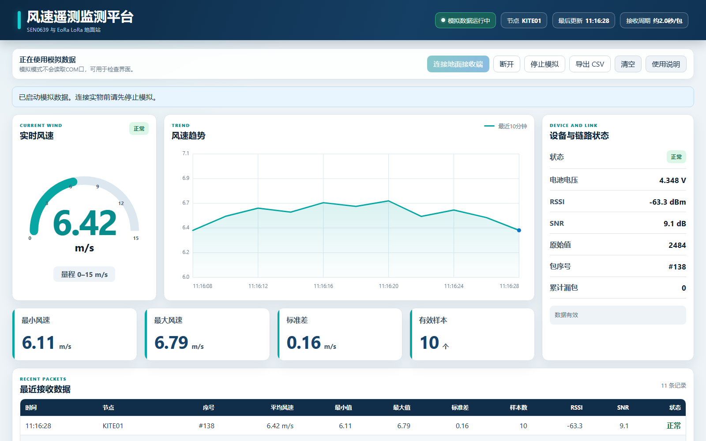

# 风筝搭载 SEN0639 LoRa 风速遥测系统（正式版）

这是带电脑网页服务的正式运行版本，包含：

- 空中端实时演示固件 `wind_tx_realtime`：读取真实风速，约每 0.5 秒发送一包，不深睡；
- 空中端联调固件 `wind_tx_test`：约每 2 秒回传一次，不深睡，用于桌面和距离测试；
- 空中端正式固件 `wind_tx`：SEN0639 采样、统计、LoRa 每分钟回传、深睡；
- 地面端正式固件 `wind_rx`：LoRa 接收、OLED 显示、USB 串口输出；
- 电脑端网页服务：实时风速仪表、趋势图、统计量、链路质量和 CSV 导出；
- 正式设计说明、程序说明和测试记录。

本发布目录不包含独立的传感器单测固件。`wind_tx_realtime`、`wind_tx_test` 与 `wind_tx` 共用 `src/tx/main.cpp`，由 PlatformIO 编译环境选择运行模式。

## 文档

- [正式设计说明](docs/01_正式设计说明.md)
- [正式程序说明](docs/02_正式程序说明.md)
- [正式测试记录](docs/03_正式测试记录.md)
- [电脑网页服务说明](dashboard/README.md)

## 系统结构

```text
SEN0639 热式风速传感器
        │ I²C GPIO41/42
        ▼
空中端 EoRa-S3-400TB / ESP32-S3
        │ 板载 SX1268，470 MHz LoRa 点对点
        ▼
地面端 EoRa-S3-400TB
        ├─ 板载 OLED
        └─ USB 串口 115200 → Edge/Chrome 风速仪网页
```

## 当前正式参数

| 项目 | 设置 |
|---|---|
| 传感器 | DFRobot SEN0639 / PAV3015，I²C 地址 `0x28` |
| 风速范围 | 0–15 m/s |
| 实时模式 `wind_tx_realtime` | 每包读取 1 次真实风速，约 0.5 s 一包，不深睡 |
| 联调模式 `wind_tx_test` | 每 200 ms 采样，10 个目标样本，约 2 s 一包，不深睡 |
| 正式模式 `wind_tx` | 每 200 ms 采样，25 个目标样本，约 60 s 一包，发送后深睡 |
| LoRa | 470 MHz、BW 125 kHz、SF7、CR 4/5、10 dBm |
| 地面串口 | 115200 baud |

## 编译与烧录

打开本目录后，在 PlatformIO 中执行：

```powershell
# 空中端0.5秒实时演示固件
pio run -e wind_tx_realtime -t upload

# 空中端快速联调固件
pio run -e wind_tx_test -t upload

# 空中端正式固件
pio run -e wind_tx -t upload

# 地面端正式固件
pio run -e wind_rx -t upload
```

实时讲解演示可烧录 `wind_tx_realtime`；距离和稳定性联调建议使用 `wind_tx_test`；正式放飞前必须重新烧录 `wind_tx`。`wind_tx_realtime` 连续采样和发射、功耗较高，只用于短时间测试。

两块板都必须先连接 410–493 MHz 匹配天线，再上电或发射。

## 启动电脑页面

1. 用 USB 数据线连接已经烧录 `wind_rx` 的地面端；
2. 双击 `dashboard/start_dashboard.bat`；
3. 浏览器打开 `http://127.0.0.1:8765/`；
4. 点击“连接串口”，选择地面端 COM 口；
5. 页面开始显示 LoRa 回传数据。

浏览器首次连接串口必须由用户点击授权，不能自动绕过。



## 数据格式

空中端发送：

```text
WV1,node,seq,avg,min,max,sd,n,raw,batt_mv,status
```

地面端向电脑追加链路质量：

```text
WV1,node,seq,avg,min,max,sd,n,raw,batt_mv,status,rssi_dbm,snr_db
```

## 验证状态

- `wind_tx_realtime`、`wind_tx_test`、正式 `wind_tx` 和 `wind_rx` 已完成编译、链接及固件镜像生成；
- 网页协议自动测试和 Python 服务脚本检查通过；
- 100 m 收包率、参考风速仪比对、功耗和电池续航仍须根据[正式测试记录](docs/03_正式测试记录.md)保存定量数据。

编译通过不等于实物距离、精度和续航已经验收。
