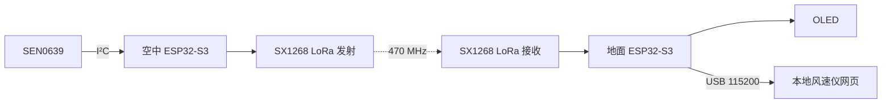
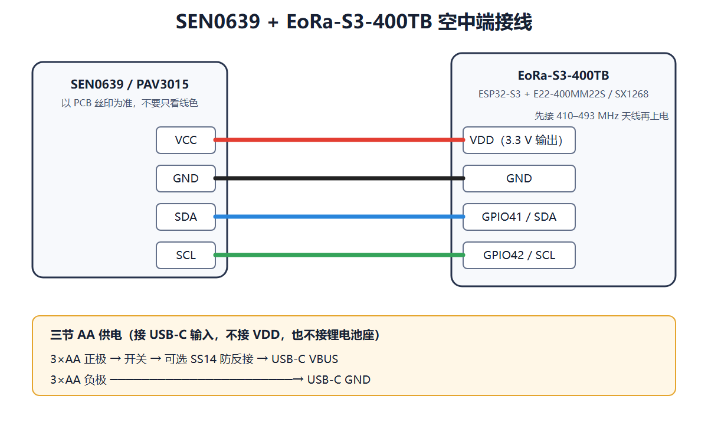

# 风筝搭载 SEN0639 LoRa 风速遥测系统正式设计说明

版本：V1.0  
整理日期：2026-11-18

## 1. 设计目标

系统将 SEN0639 热式风速传感器随风筝升空，空中端定时采集风速并通过 LoRa 点对点链路回传。地面端将数据同时显示在 OLED 和电脑网页上。

正式版本目标：

| 项目 | 设计值 |
|---|---|
| 目标距离 | 100 m 视距，最终以实测为准 |
| 回传周期 | 约 60 s |
| 风速传感器 | SEN0639 / PAV3015，0–15 m/s |
| 空中/地面主板 | EoRa-S3-400TB |
| 无线模块 | 板载 E22-400MM22S / SX1268 |
| 通信方式 | 470 MHz LoRa 点对点 |
| 电脑显示 | 本地网页服务 + Web Serial |

## 2. 系统组成



SEN0639 是纯 I²C 从设备，不能自行发送 LoRa。ESP32-S3 负责传感器读取、统计、数据包组织和射频控制。

## 3. 空中端接线

| SEN0639 | EoRa-S3-400TB | 作用 |
|---|---|---|
| VCC | VDD / 3.3 V 输出 | 传感器供电 |
| GND | GND | 公共地 |
| SDA | GPIO41 | I²C 数据 |
| SCL | GPIO42 | I²C 时钟，100 kHz |



I²C 线建议不超过 20 cm，并固定插头和线缆。以 PCB 丝印判断接线，不只依赖线色。板载 OLED 使用 GPIO18/17，与外接传感器总线分开。

板载 LoRa 引脚：

| 功能 | GPIO |
|---|---|
| SCLK / MISO / MOSI / CS | 5 / 3 / 6 / 7 |
| RESET / DIO1 / BUSY | 8 / 33 / 34 |

## 4. 正式采集算法

空中端唤醒后等待传感器预热，然后以 200 ms 间隔读取数据，目标为 25 个样本，采样窗口约 5 s。

每次 I²C 读取检查：

1. 是否收到完整 5 字节；
2. 数据是否全零或全 `0xFF`；
3. 5 字节累加和低 8 位是否为零；
4. 是否达到 15 m/s 饱和上限。

程序计算平均、最小、最大、总体标准差、有效样本数和平均原始量。单次失败会短暂重试一次，错误状态写入数据包。

风速转换采用 DFRobot PAV3000 官方驱动中的 13 个标定点，并在相邻点之间线性插值。

## 5. 正式通信参数

| 参数 | 值 |
|---|---:|
| 频率 | 470.000 MHz |
| 带宽 | 125 kHz |
| 扩频因子 | SF7 |
| 编码率 | 4/5 |
| Sync word | `0x12` |
| 发射功率 | 10 dBm |
| 前导码 | 8 symbols |
| TCXO | 1.6 V |

两端必须使用完全相同的参数。当前协议为单向遥测，没有确认和重发。

数据格式：

```text
WV1,node,seq,avg,min,max,sd,n,raw,batt_mv,status
```

地面端追加 `rssi_dbm` 和 `snr_db` 后从 USB 串口输出。

状态位：

| 数值 | 含义 |
|---:|---|
| 0 | 正常 |
| 1 | 未发现传感器 |
| 2 | 无有效样本 |
| 4 | 存在读取或校验错误 |
| 8 | 达到 15 m/s 上限 |

## 6. 正式工作流程

```text
空中端定时唤醒
  → 关闭 Wi-Fi/蓝牙
  → 初始化 SEN0639 和 SX1268
  → 预热并采集 25 点
  → 计算统计量并组成 WV1 包
  → LoRa 发送一次
  → 关闭 SPI/I²C并深睡
  → 补足约 60 s 周期后再次唤醒

地面端持续接收
  → CRC 与 WV1 格式检查
  → OLED 显示
  → USB 串口输出
  → 网页解析、显示和保存 CSV
```

## 7. 网页服务设计

网页服务只运行在电脑本地：

- Python 提供 `http://127.0.0.1:8765/` 静态页面；
- Edge/Chrome 使用 Web Serial 连接地面端；
- 页面解析 WV1 数据并显示风速仪表、趋势、极值、标准差、样本数、RSSI、SNR、电池字段和包序号；
- 用户可导出 CSV；
- 不依赖公网和云服务器。

## 8. 供电设计

当前空中端使用三节 AA 电池串联，经开关送入 USB-C VBUS。接板前必须用万用表确认极性，并确认最高电压不超过开发板 5.0 V 上限。

不得把电池接到 VDD/3V3，也不得用板载单节锂电充电电路给三节 AA 充电。天线必须先连接再上电。

ESP32-S3 在两次上报之间进入深睡，但 SEN0639 仍持续消耗约 10 mA，因此实际整机平均电流和续航必须测量，不能按 ESP32 深睡电流直接估算。

## 9. 测量边界

传感器随风筝移动，读数表示传感器位置和姿态下的相对气流，不等同固定气象站的绝对水平风速。风筝平动、摆动、进风夹角、盒体尾流和线振动都会影响结果。

传感器进风口应伸出盒体和风筝尾流区，天线远离电池、碳纤维件和大面积金属。正式使用前应与可信参考风速仪在至少三个风速点并排对比。

## 10. 验收边界

当前正式源码和网页服务可以构建运行，但下列项目必须取得原始测试记录后才能声明验收：

- 100 m 最终安装状态收包率；
- 参考风速仪比对误差；
- 三节 AA 负载电压、平均电流和续航；
- 实际悬挂状态下的姿态、尾流和振动影响。
